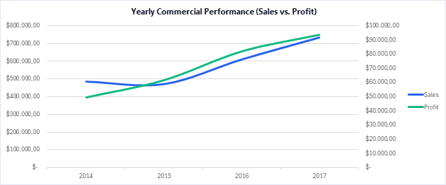
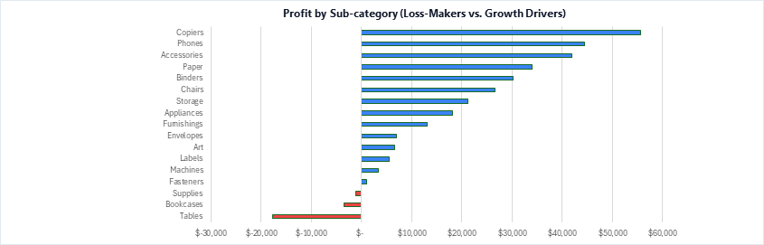
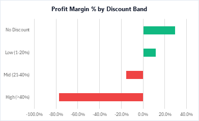
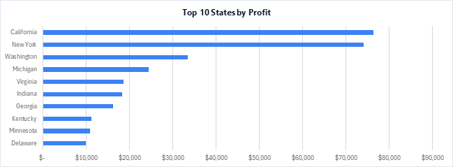

# E-Commerce Commercial & Profitability Analysis (Superstore)
### Executive Excel & Power Query BI Dashboard for Retail Performance

---

## Project Overview
An end-to-end commercial analytics and business intelligence project built in Microsoft Excel and Power Query to analyze four years (2014–2017) of U.S. retail transaction records, comprising 9,994 order-line records across 5,009 distinct orders.

The primary commercial objective is to evaluate reported profit margin dynamics, examine discounting patterns, assess regional and product-level profitability, and identify data-driven optimization opportunities for executive review.

---

## Dashboard Preview

| Multi-Year Performance Trend | Profitability by Subcategory |
| :---: | :---: |
|  |  |

| Profit Margin by Discount Band | Top 10 States by Profit |
| :---: | :---: |
|  |  |

---

## Skills Demonstrated

* **Microsoft Excel:** Executive dashboard design, 11 synchronized PivotTables, dynamic Slicers (`Region`, `Order Year`), customized shape KPI cards linked dynamically to backend cells, dual-axis commercial trend modeling, diverging bar charts, and standardized US number/currency formatting (`$#,##0.00`).
* **Power Query (ETL & M):** Automated data ingestion pipeline, explicit data typing (`en-US` locale enforcement for dates and currencies), schema standardization, and custom M feature engineering (`Profit Margin %`, `Days to Ship`, `Profit Flag`, `Discount Band`, `Quarter`, `Order Month Name`).
* **Commercial & Business Analytics:** Dataset-reported profit margin analysis, discount sensitivity analysis, year-over-year commercial tracking (+51.4% sales, +88.6% profit), product portfolio evaluation, customer segment profiling, and fulfillment turnaround assessment.
* **Data Visualization & BI Reporting:** Visual hierarchy, clean card layouts, secondary axis labeling, intentional color coding (Emerald for profit leaders, Coral for loss-makers, Slate for neutrals), and executive presentation exports.

---

## Data Source & Limitations

* **Origin & Nature:** The analysis utilizes the widely recognized **Sample - Superstore** dataset, an established retail benchmarking dataset representing commercial sales orders across the contiguous United States from 2014 through 2017.
* **Sample & Demonstrative Scope:** The dataset is demonstrative and designed for business intelligence, commercial modeling, and analytics portfolio demonstration.
* **Geographical Scope:** Covers 4 U.S. geographic regions (Central, East, South, West) across 49 states/districts. Findings reflect retail commercial dynamics within the U.S. domestic market during the 2014–2017 period.
* **Accounting & Metric Scope:** The dataset records transaction-level `Sales`, `Quantity`, `Discount`, and `Profit`. Profitability metrics in this project reflect **Dataset-reported Profit**, as the dataset does not provide an explicit accounting definition or itemized cost structure (such as cost of goods sold, corporate overhead, warehousing operations, or administrative expenses). Consequently, reported profit figures should not be interpreted as a complete GAAP operating or gross profit calculation.

---

## Key Business Questions Addressed

1. **Portfolio Profitability:** Which product categories and subcategories record negative aggregate profit, and by how much?
2. **Discount Sensitivity:** How does discounting correlate with bottom-line profitability across order bands?
3. **Geographic Performance:** Which regions and states generate high top-line revenue but record negative margins?
4. **Segment Contribution:** How do customer segments (Consumer, Corporate, Home Office) compare in terms of revenue volume and return on sales?
5. **Time Series & Seasonality:** How consistent is year-over-year commercial expansion, and how does margin hold during peak Q4 volume?
6. **Fulfillment Logistics:** How do shipping modes relate to sales volume, delivery turnaround, and profitability?

---

## Data Architecture & Technical Workflow

```
[Raw CSV Dataset] (9,994 Order-Line Records)
       │
       ▼
[Power Query ETL Engine (M)]
   ├── Ingestion & Type Enforcement (Locale: en-US)
   ├── Feature Engineering:
   │     • Profit Margin % = Profit / Sales
   │     • Days to Ship = Duration.Days(Ship Date - Order Date)
   │     • Profit Flag = Profitable / Break-even / Loss
   │     • Discount Band = No Discount (0%) / Low (1-20%) / Mid (21-40%) / High (>40%)
   │     • Time Intelligence = Year, Quarter, Month Name (en-US)
       │
       ▼
[Clean Data Table] (Sample___Superstore__2)
       │
       ▼
[Analytical Backend: 11 PivotTables] (Sheet: Pivot)
   ├── Cross-filtered by 2 Global Slicers (Region, Order Year)
       │
       ▼
[Executive Presentation Layer] (Sheet: Dashboard)
   ├── 5 Dynamic KPI Cards (Sales, Profit, Margin %, Orders, AOV)
   ├── Dual-Axis Trend Chart (Sales vs. Profit with explicit axis scales)
   ├── Diverging Subcategory Bar Chart (Loss-makers vs. Profit drivers)
   ├── Discount Band Margin Matrix
   ├── Geographic Profit Ranking (Top 10 States)
   └── Customer Segment Margin Breakdown
```

---

## Core Business Findings & Data Insights

| Analysis Area | Key Metric | Empirical Finding |
| :--- | :--- | :--- |
| **Top-Line Growth** | **+51.4% Sales** | Annual revenue expanded from \$484,247 (2014) to \$733,215 (2017). |
| **Bottom-Line Growth** | **+88.6% Profit** | Annual profit grew from \$49,544 (2014) to \$93,439 (2017). Overall dataset-reported profit margin improved from 10.23% in 2014 to 12.74% in 2017 (peaking at 13.43% in 2016). |
| **Q4 Seasonal Surge** | **38.2% of Sales** | Q4 generated \$878,078 in sales (38.2% of total volume) and \$110,622 in profit (38.6% of total profit) over 4 years, holding a 12.60% profit margin during peak volume. |
| **Discount Margin Compression** | **-$135,376 Profit Drag** | Orders discounted above 20% generated an aggregate negative profit of -$135,376 (-37.3% weighted margin). Mid discounts (21–40%) recorded -$35,817 (-15.3% margin), while High discounts (>40%) recorded -$99,559 (-77.4% margin). |
| **Loss-Making Subcategories** | **-$22,387 Profit Drag** | Three subcategories recorded negative aggregate profit: Tables (-$17,725 loss, -8.56% margin), Bookcases (-$3,473 loss, -3.02% margin), and Supplies (-$1,189 loss, -2.55% margin). |
| **Regional Profitability Risks** | **Texas & Ohio** | Ten states recorded negative aggregate profit, led by Texas (-$25,729 loss, -15.1% margin on \$170k sales) and Ohio (-$16,971 loss, -21.7% margin on \$78k sales). In both states, average discount rates exceeded 30%. |
| **Powerhouse States** | **California & NY** | California (\$76,381 profit) and New York (\$74,039 profit) generated over 52.5% of total company profit (\$150,420 combined) on \$769k in sales. |
| **Segment Profitability** | **Home Office (14.03%)** | Consumer drove the largest absolute volume (\$134,119 profit, 50.6% of sales, 11.55% margin), while Home Office achieved the highest return on sales (14.03% margin), led by Office Supplies at 20.84% margin. |
| **Fulfillment Turnaround** | **First Class (13.93%)** | Expedited First Class shipping recorded the highest reported profit margin (13.93% on \$351k sales, averaging 2.18 days). While this suggests that premium fulfillment customers may be less price-sensitive, this represents a commercial hypothesis requiring further validation (e.g., examining order urgency and customer mix) before adjusting fulfillment pricing. |

---

## Strategic Executive Recommendations

1. **Pilot Discount Governance & Guardrails:**
   * Establish a baseline policy capping standard sales discounts at **20%**, requiring Regional Management authorization for discounts between 21% and 40%, and restricting discounts >40% to documented clearance.
   * *Implementation Caution:* Deep discounts may currently drive customer acquisition or inventory clearance; reducing discounts could impact sales volume. Introduce this policy as a controlled regional pilot to measure net profit recovery against demand elasticity.
2. **Turn Around the Furniture Portfolio:**
   * Conduct an operational review of Tables (-$17.7k loss) and Bookcases (-$3.5k loss).
   * Audit regional promotional practices on Tables in the Central and East regions where losses are concentrated. As a strategic hypothesis to test, evaluate whether freight renegotiations, targeted price adjustments, or separate delivery fee structures for bulky furniture could improve unit economics, subject to market testing and competitor benchmark validation.
3. **Realign Sales Commission Structures:**
   * In persistent loss-making states (Texas, Ohio, Pennsylvania), transition sales commission models from top-line revenue volume to dataset-reported profit or margin.
   * This aligns sales representative incentives with bottom-line contribution and discourages margin-sacrificing discounting.
4. **Scale High-Margin Categories & Customer Segments:**
   * Formulate a strategic hypothesis to evaluate allocating promotional and sales focus toward high-margin subcategories such as Technology hardware (Phones, Accessories, Copiers) and Home Office supplies (20.84% margin).
   * Validate this strategy against customer acquisition costs (CAC) and inventory lead times before committing marketing capital, exploring product bundling to protect overall transaction margins.

---

## Analytical Limitations

* **Correlation vs. Causation:** The dataset establishes a strong correlation between deep discounting (>20%) and negative profit margins. However, observational data does not prove that discounts caused negative profitability—discounted products may have suffered from lower intrinsic demand, higher supplier costs, or inventory clearance pressures.
* **Price Elasticity & Volume Sensitivity:** Eliminating discounts above 20% assumes demand remains constant. In practice, demand is price-elastic, meaning higher net prices could reduce sales volume. Controlled A/B testing is recommended before enterprise-wide policy changes.
* **Cost Data Granularity:** The dataset provides transaction-level revenue, discount, and profit figures, but lacks documentation on cost attribution, warehousing, freight surcharges, or customer acquisition costs. All profit and margin analyses reflect **Dataset-reported Profit** rather than fully burdened accounting profit.

---

## How to Explore & Run

### 1. Clone the Repository
```bash
git clone https://github.com/Simone0801/excel-superstore-sales-analysis.git
cd excel-superstore-sales-analysis
```

### 2. Open the Interactive Workbook
* Open `Data Analysis project - Superstore.xlsx` in Microsoft Excel (Excel 2016 or newer / Microsoft 365 recommended).
* Navigate to the **`Dashboard`** worksheet.
* Interact with the **`Region`** and **`Order Year`** slicers to cross-filter all 5 charts and KPI cards in real time.
* Review detailed analytical commentary and strategic recommendations on the **`Insights`** worksheet.
* View the executive PDF report formatted for instant one-page presentation: `Dashboard_Presentation.pdf`.

### 3. How to Reconnect Data Source in Power Query (Reproducibility)
The workbook contains a fully automated Power Query pipeline. If you wish to refresh or modify the query on another machine:
1. Open `Data Analysis project - Superstore.xlsx`.
2. Go to the **Data** tab on the Excel ribbon and click **Queries & Connections**.
3. In the Queries pane on the right, double-click **`Sample - Superstore (2)`** to open the Power Query Editor.
4. In the **Applied Steps** pane on the right-hand side, click the gear icon next to the first step: **`Source`**.
5. Click **Browse**, navigate to your local cloned repository directory, and select **`Sample - Superstore.csv`**.
6. Click **OK**, then click **Close & Load** (top-left of Home tab).
7. The table, PivotTables, and dashboard will refresh seamlessly.

---

## Repository Structure

```
excel-superstore-sales-analysis/
├── 1_Yearly_Performance.png              # Multi-year dual-axis trend chart (Sales vs. Profit)
├── 2_Profit_By_Subcategory.png           # Diverging bar chart (Loss-makers vs. Growth drivers)
├── 3_Profit_Margin_By_Discount.png       # Profit margin % by discount band matrix
├── 4_Top_10_States_Profit.png            # Geographic profit rankings (Top 10 States)
├── 5_Profit_Margin_By_Segment.png        # Category margin distribution by customer segment
├── Dashboard_Presentation.pdf            # Executive one-page presentation PDF (Landscape)
├── Data Analysis project - Superstore.xlsx # Master interactive Excel workbook (ETL, Pivot, Dashboard, Insights)
├── README.md                             # Comprehensive project documentation & analytics report
└── Sample - Superstore.csv               # Raw retail dataset (9,994 order-line records, 2014-2017)
```

---

## Author & Contact
* **Analyst:** Simone (Junior Data Analyst & Business Intelligence Specialist)
* **Repository:** [excel-superstore-sales-analysis](https://github.com/Simone0801/excel-superstore-sales-analysis.git)
